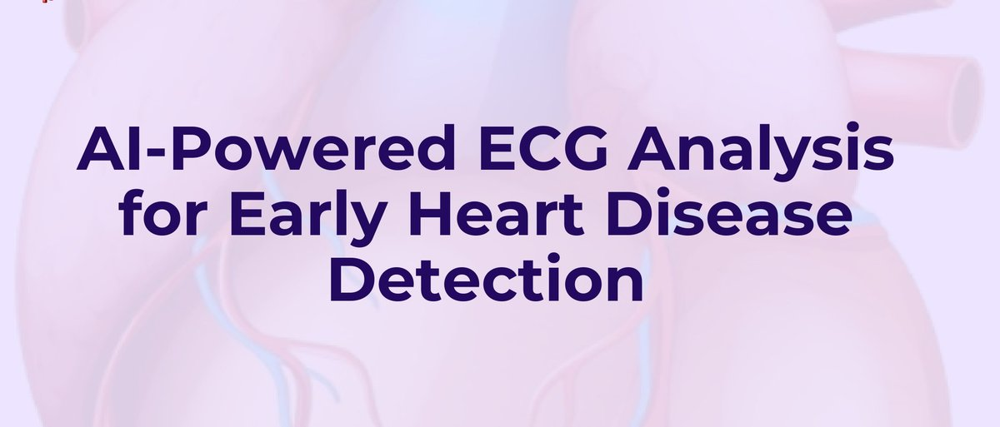
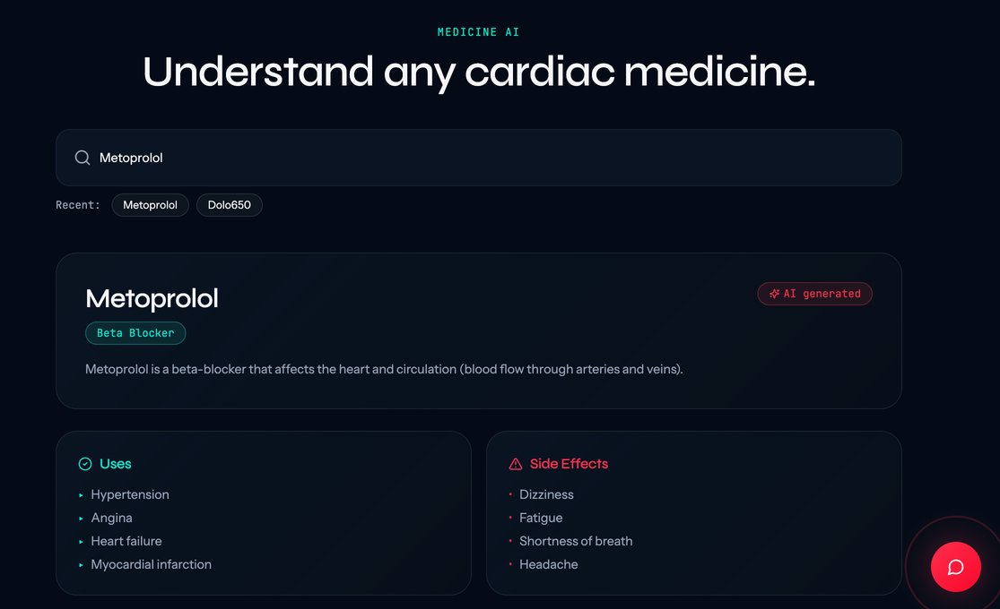
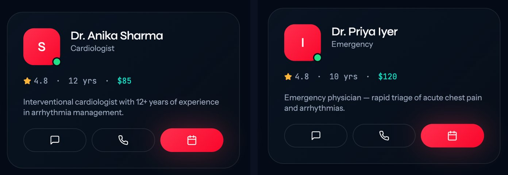
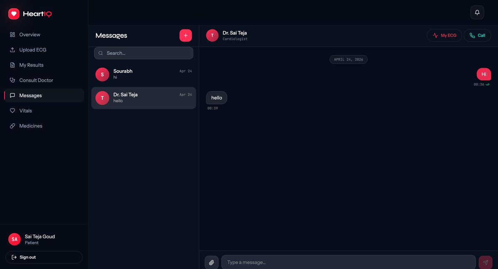
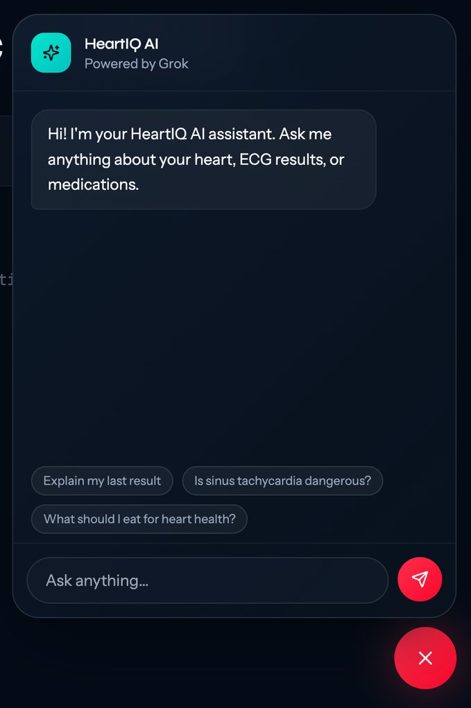
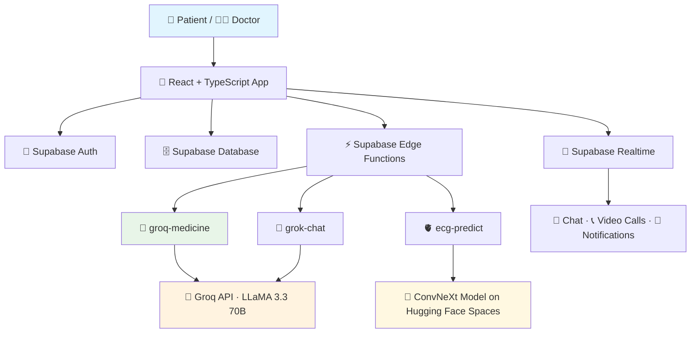
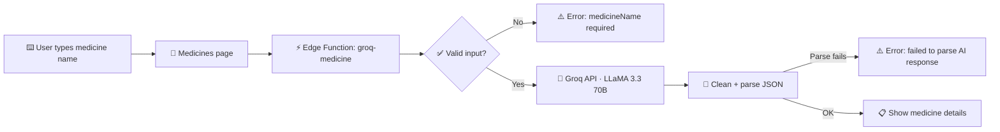
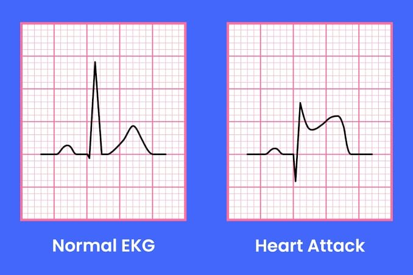
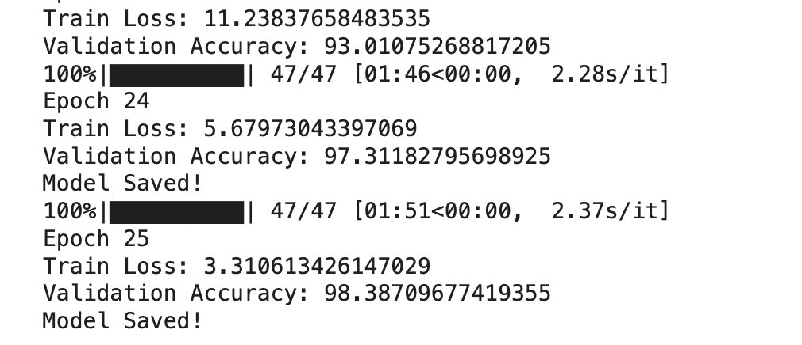
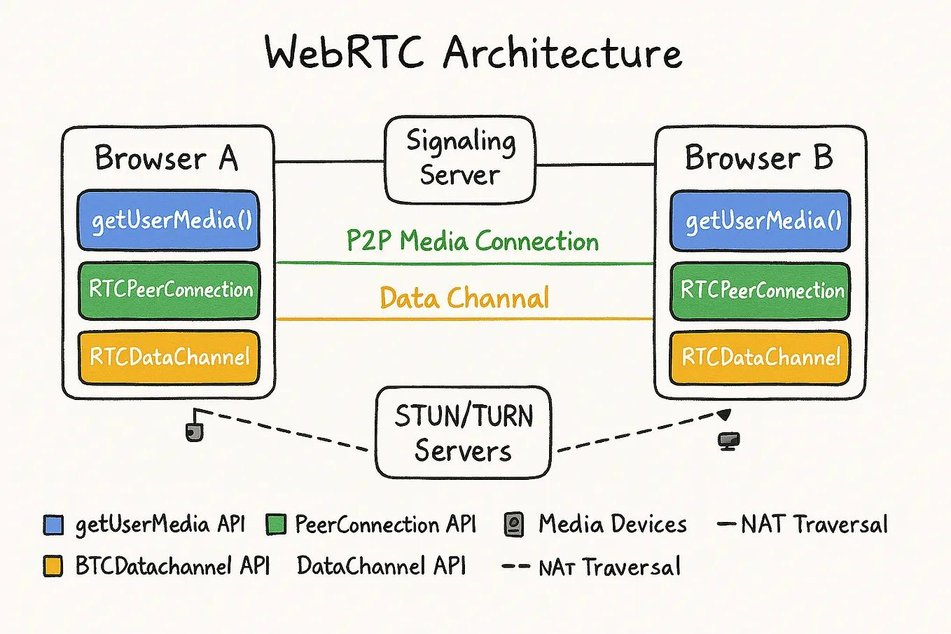

<div align="center">

# ❤️ HeartIQ – AI-Powered Cardiac Healthcare Platform



<p align="center">
  
  
  
  
  
  
  
  
  
</p>

---

## 🎯 Project Vision

Bring **AI-assisted heart care** to patients and doctors in one place. HeartIQ lets patients upload an ECG for AI classification, ask health questions to an AI assistant, look up medicines, and consult doctors through real-time chat and video calls, while doctors manage patients, appointments and ECG reviews from their own dashboard.

> **🚀 Mission**: Make early cardiac screening and reliable health information easy to reach for everyone.

</div>

### ❓ **Problem Statement**

Manual ECG reading leads to:
- 🧠 Subjective interpretation
- ⏳ High workload for clinicians
- 🐢 Delayed identification of abnormalities

Many patients do not get regular cardiac screenings. There is a need for **automated, accurate and explainable ECG diagnosis**, plus an easy way to reach a doctor.

---

## 📸 Screenshots

<table>
<tr>
<td width="50%" align="center"><br/><b>💊 Medicines AI</b></td>
<td width="50%" align="center"><br/><b>🩺 Consult a Doctor</b></td>
</tr>
<tr>
<td width="50%" align="center"><br/><b>💬 Real-Time Chat</b></td>
<td width="50%" align="center"><br/><b>🤖 HeartIQ AI Chatbot</b></td>
</tr>
</table>

---

## 📋 Table of Contents

- [🌟 Key Features](#-key-features)
- [🔧 Technology Stack](#-technology-stack)
- [📸 Screenshots](#-screenshots)
- [📊 System Architecture](#-system-architecture)
- [🎪 Live Demo](#-live-demo)
- [💊 Medicines AI Module (My Contribution)](#-medicines-ai-module-my-contribution)
- [🫀 ECG Analysis Model](#-ecg-analysis-model)
- [🩺 Consult, Chat and Video Call](#-consult-chat-and-video-call)
- [🤖 HeartIQ AI Chatbot](#-heartiq-ai-chatbot)
- [🛡️ Security and Reliability](#️-security-and-reliability)
- [🗄️ Database](#️-database)
- [🧪 UI/UX Testing](#-uiux-testing)
- [🌍 Real-World Applications and Future Scope](#-real-world-applications-and-future-scope)
- [📁 Project Structure](#-project-structure)
- [⚡ Quick Start Guide](#-quick-start-guide)
- [👩‍💻 Author](#-author)

---

## 🌟 Key Features

<table>
<tr>
<td width="50%">

### 🧑‍⚕️ **For Patients**
- 🫀 Upload an ECG and get AI classification
- 💊 Medicines AI: uses, dosage, side effects, interactions
- 🤖 AI health chatbot
- 📅 Book doctor consultations
- 💬 Real-time chat and 📞 video calls with doctors
- 📈 Vitals tracking with alert thresholds
- 🔔 Notifications

</td>
<td width="50%">

### 👨‍⚕️ **For Doctors**
- 📊 Doctor dashboard
- 👥 Patient list and patient details
- 🗂️ ECG review queue
- 📅 Appointments and availability slots
- 📝 Patient notes and prescriptions
- 💬 Chat and video calls with patients

</td>
</tr>
</table>

---

## 🔧 Technology Stack

<div align="center">

| Category | Technologies |
|----------|-------------|
| **🎨 Frontend** |        |
| **🗄️ Backend** |  Auth · PostgreSQL · Realtime · Edge Functions |
| **🤖 Generative AI** |   |
| **🫀 ECG Model** |  ConvNeXt ·  on  |
| **📞 Video Calls** | WebRTC with Supabase Realtime signalling |
| **🛠️ Built with** | Lovable (AI-assisted development) |

</div>

---

## 📊 System Architecture



---

## 🎪 Live Demo

<div align="center">

🌐 **Experience the app live:** [heartiq.lovable.app](https://heartiq.lovable.app)

🫀 **ECG model API:** [haswanth875-heartiq-model.hf.space/docs](https://haswanth875-heartiq-model.hf.space/docs)

</div>

---

## 💊 Medicines AI Module (My Contribution)

<div align="center">

### 🔍 **Search any medicine, get structured information instantly**

</div>

<p align="center"></p>

#### 🔗 **How It Works**



#### 📋 **Information Shown**

<table>
<tr>
<td width="50%">

- 🏷️ Name and category
- 📝 Description
- ✅ Uses
- 💉 Dosage: adult, child, elderly
- ⚠️ Side effects

</td>
<td width="50%">

- 🚫 Warnings and contraindications
- 🔄 Drug interactions with severity (Low / Medium / High)
- 🔁 Alternatives
- 📦 Storage instructions
- 🤰 Pregnancy safety

</td>
</tr>
</table>

#### 🧠 **Design Decisions**

| Decision | Why |
|----------|-----|
| **System prompt asks for JSON only**, with fixed fields | The app can display every section reliably |
| `response_format: json_object` | Forces the model to return valid JSON |
| **Temperature 0.3** | Keeps answers consistent and factual |
| **Input validation** | Empty or invalid names return a clear error |
| **JSON cleaning step** | Removes code fences or extra text before parsing |
| **Error instead of guessing** | If the reply can't be parsed, the user sees an error, not wrong data |
| **API key as a server-side secret** | The Groq key lives in Supabase secrets, never in frontend code |

```typescript
// supabase/functions/groq-medicine/index.ts (simplified)
const resp = await fetch("https://api.groq.com/openai/v1/chat/completions", {
  method: "POST",
  headers: { Authorization: `Bearer ${API_KEY}`, "Content-Type": "application/json" },
  body: JSON.stringify({
    model: "llama-3.3-70b-versatile",
    response_format: { type: "json_object" },
    temperature: 0.3,
    max_tokens: 1500,
    messages: [
      { role: "system", content: SYSTEM_PROMPT },
      { role: "user", content: `Medicine: ${medicineName}` },
    ],
  }),
});
```

📂 Code: [`supabase/functions/groq-medicine/index.ts`](supabase/functions/groq-medicine/index.ts) · [`src/pages/Medicines.tsx`](src/pages/Medicines.tsx)

> ⚠️ Medicine information is AI-generated and for learning purposes only. It is not medical advice.

---

## 🫀 ECG Analysis Model

<div align="center">

</div>

#### 📚 **Dataset**

**ECG Images Dataset of Cardiac Patients** by Ali Haider Khan and Muzammil Hussain (University of Management and Technology, 2021). About **11,148 ECG images** in four classes:

<div align="center">

| Class | Images |
|-------|-------:|
| ✅ Normal ECG | 3,408 |
| 🚨 Myocardial Infarction | 2,880 |
| 💓 Abnormal Heartbeat | 2,796 |
| 📜 History of MI | 2,064 |

</div>

#### 🔧 **Preprocessing and Augmentation**

| Step | Details |
|------|---------|
| **Resize** | All images resized to **384 × 384** |
| **Normalize** | Pixel values normalized for stable training |
| **Tensors** | Images converted to tensors for PyTorch |
| **Augmentation** | Horizontal flip, brightness and contrast changes, Gaussian blur, rotation and scaling, to reduce overfitting |

#### 🧠 **Why ConvNeXt?**

ConvNeXt (Meta AI, 2022) is a modern CNN that borrows ideas from Vision Transformers:
- Depthwise convolutions that are computationally efficient
- Larger **7×7 kernels** that capture more spatial context
- Inverted bottleneck blocks (from MobileNet)
- Layer Normalization for more stable training
- **Transfer learning** from pretrained ImageNet weights

#### 📈 **Model Accuracy**

<div align="center">

🏆 **Validation accuracy: 98.39%** (epoch 25)



</div>

#### 🚀 **Deployment**

- The trained `.pth` model is packaged with **Docker** and deployed on **Hugging Face Spaces**.
- The app calls it through the `ecg-predict` Edge Function and shows the predicted class with probabilities on the **Results** page.
- Live API docs: [haswanth875-heartiq-model.hf.space/docs](https://haswanth875-heartiq-model.hf.space/docs)

---

## 🩺 Consult, Chat and Video Call

<table>
<tr>
<td width="50%">

### 🩺 **Consult a Doctor**
- Find verified doctors by **specialty, availability and rating**
- Start a chat, a video call, or book an appointment

### 💬 **Real-Time Chat**
- Built on **Supabase Realtime** subscriptions
- Text messages, ECG files and PDF reports
- Updates instantly without refreshing

`Patient → Select Doctor → Open Chat → Send Messages/Files → Doctor Response`

</td>
<td width="50%">

### 📞 **Video Call (WebRTC)**
- Peer-to-peer audio and video between patient and doctor
- **STUN servers** discover public IP addresses
- **Supabase** handles signalling for call setup
- Camera control and microphone mute

`Patient → Request Call → Doctor Accepts → WebRTC Connection → Live Consultation`

</td>
</tr>
</table>

<div align="center">

</div>

---

## 🤖 HeartIQ AI Chatbot

- A cardiology assistant powered by **LLaMA 3.3 70B** through the **Groq API** (`grok-chat` Edge Function).
- It knows which page the user is on, so answers fit the context.

---

## 🛡️ Security and Reliability

| Feature | Details |
|---------|---------|
| 🔐 **Authentication** | Supabase Auth with separate patient and doctor views |
| 🔑 **Secret API keys** | Stored server-side in Supabase, not in the app code |
| ⏱️ **Session timeout** | Warning at 25 minutes idle, automatic sign-out at 30 minutes |
| 🚦 **Rate limiting** | Limits on AI chatbot and medicine searches; maximum 10 ECG uploads per day, checked on the server |
| 📜 **Audit log** | Important actions are recorded in an `audit_log` table |
| 📴 **Offline banner** | Shows a notice when the internet connection drops |
| 🧯 **Error boundary** | Shows a friendly screen instead of a crash |

---

## 🗄️ Database

Supabase PostgreSQL tables include:

`profiles` · `ecg_uploads` · `consultations` · `conversations` · `messages` · `call_sessions` · `notifications` · `prescriptions` · `patient_notes` · `availability_slots` · `vitals_readings` · `alert_thresholds` · `audit_log`

---

## 🧪 UI/UX Testing

- Collected user feedback through **Google Forms** and analysed it
- Tested responsiveness, navigation and overall experience
- Found and fixed UI bugs, performance issues and layout problems
- Verified ECG prediction, AI chatbot, video consultation and real-time chat

---

## 🌍 Real-World Applications and Future Scope

<table>
<tr>
<td width="50%">

### 🏥 **Applications**
- Automated ECG screening in hospitals
- Telemedicine and remote healthcare
- Emergency heart monitoring and rapid analysis
- Smart AI-based healthcare systems

</td>
<td width="50%">

### 🔭 **Future Scope**
- Smartwatch and wearable ECG integration
- Mobile healthcare app
- Cloud-based scalable deployment
- Explainable AI and multi-disease prediction

</td>
</tr>
</table>

---

## 📁 Project Structure

```
src/
├── pages/              Patient pages: Dashboard, Upload, Results, Medicines, Chat, Consult, Vitals, Call
├── pages/doctor/       Doctor pages: Dashboard, Patients, PatientDetail, Appointments, Availability, EcgQueue
├── components/         Chatbot, ECG canvas, app shells, notifications, onboarding
├── hooks/              Chat, conversations, notifications, rate limit, session timeout
├── context/            Auth and smartwatch context
└── integrations/       Supabase client
supabase/
├── functions/          groq-medicine · grok-chat · ecg-predict
└── migrations/         Database schema
screenshots/            Images used in this README
```

---

## ⚡ Quick Start Guide

<details>
<summary><b>🚀 Click to expand installation steps</b></summary>

### 1️⃣ Prerequisites
```bash
node --version   # Node.js 18 or later
```

### 2️⃣ Clone Repository
```bash
git clone https://github.com/Manasa1711/heartiq.git
cd heartiq
```

### 3️⃣ Install Dependencies
```bash
npm install
```

### 4️⃣ Add Environment Variables
```bash
cp .env.example .env
# Fill in your own Supabase project URL and publishable key
```
Set `GROQ_API_KEY` as a secret in your Supabase project for the AI functions.

### 5️⃣ Launch Application
```bash
npm run dev
```

### 6️⃣ Open in Browser
Navigate to `http://localhost:8080` (or the URL shown in the terminal).

</details>

---

## 👩‍💻 Author

<div align="center">

**Mukkara Manasa** · Medicines AI module

B.Tech Computer Science and Engineering, Lovely Professional University

📧 [manasamukkara1711@gmail.com](mailto:manasamukkara1711@gmail.com) &nbsp;|&nbsp; 🔗 [LinkedIn](https://www.linkedin.com/in/manasa-mukkara-77290824a) &nbsp;|&nbsp; 💻 [GitHub](https://github.com/Manasa1711)

*HeartIQ was built as a team project.*

</div>
